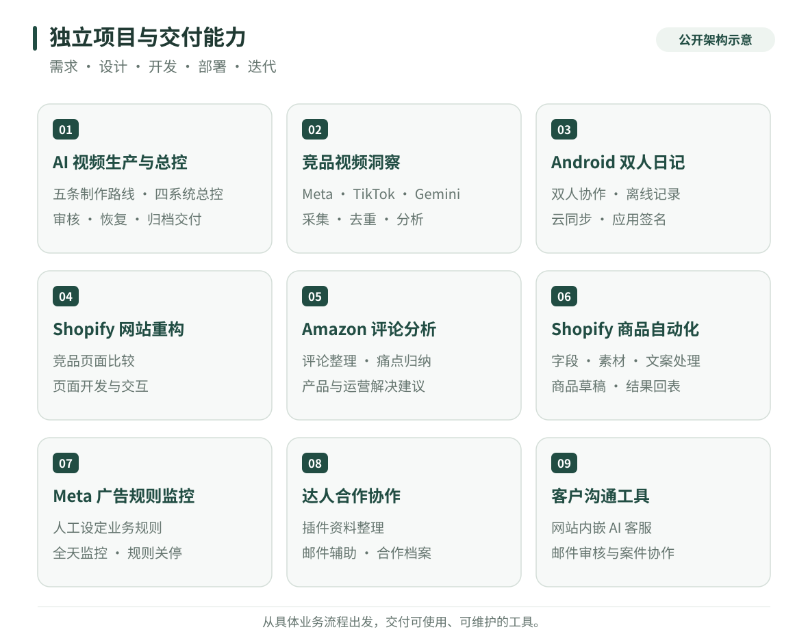
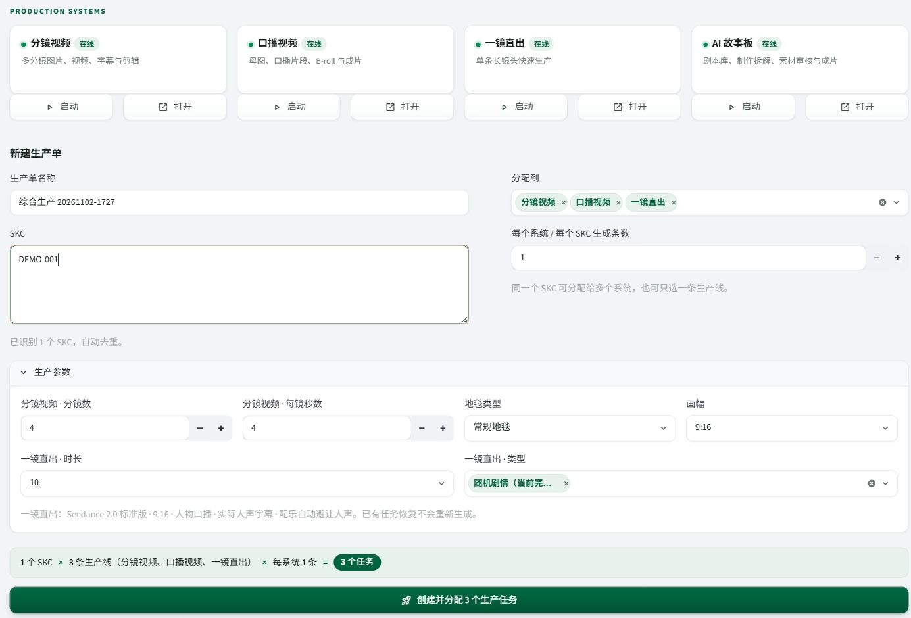
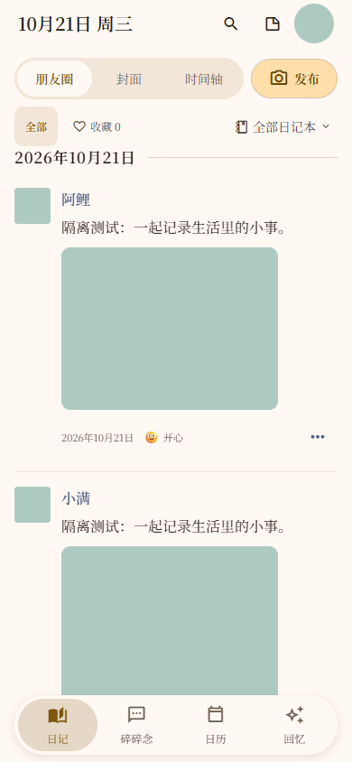
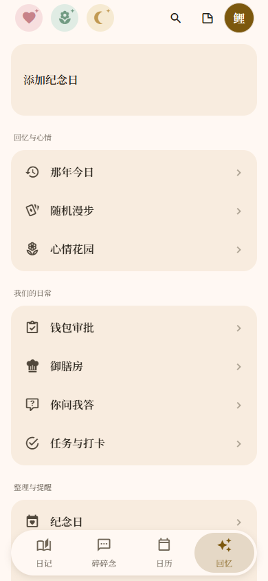

# 电商 AI 自动化与独立产品开发

**从业务问题、流程设计，到可部署工具和持续维护，我独立完成交付。**

我帮助电商与内容团队，把素材采集、视频分析、内容生产、商品运营和客户服务中的重复工作，整理成可以实际运行的系统。也独立开发并持续维护 Android 双人生活记录产品。

AI automation · E-commerce systems · Browser extensions · Independent Android product

| 5 条视频制作路线 | 4 套系统统一编排 | 10 个专题案例 | 1 款独立 Android 产品 |
| :---: | :---: | :---: | :---: |
| 分镜、口播、整片、剧本、参考片复刻 | 派单、审核、恢复、归档与交付 | 内容、数据、运营、协作与移动端 | 交互、云端、离线数据与版本发布 |

**我的工作覆盖：** 发现需求 → 拆解业务规则 → 产品与流程设计 → 开发集成 → 测试部署 → 使用交接 → 迭代维护。

## 三个代表案例

### 01 · AI 视频生产与协作交付体系

围绕五种不同内容结构开发生产工具，并通过总控连接其中四套。工程范围包括模型请求、跨任务依赖、人工审核、局部重做、异常恢复、共享角色、媒体后处理和飞书交付。

**值得看的部分：** 多系统适配如何组织；已付费任务如何恢复；素材版本如何与审核绑定；并发发布如何维持统一编号。

[阅读完整案例 →](cases/ai-video-production.md) · [查看工程设计说明 →](technical-notes.md)

### 02 · 竞品视频采集与内容洞察

开发 Meta 广告库采集插件、TikTok 竞品视频收集工具，以及 Gemini 视频分析与素材库回写流程。将分散的页面、媒体和观看判断转成可检索、可比较、可继续制作的素材记录。

**值得看的部分：** 广告与视频的关联、跨入口去重、多模态结构化分析、业务字段映射，以及人工状态保护。

[阅读采集与分析案例 →](cases/competitor-video-intelligence.md)

### 03 · Android 双人生活记录 App

独立开发从日记、相册和回忆，到双人协作、积分互动、云同步和备份的完整产品，并持续维护签名安装包。覆盖界面交互、前端、云端事务和 Android 原生能力。

**值得看的部分：** 离线队列与版本冲突、带原图备份、积分幂等、角色边界、Keystore 激活与覆盖升级。

 

[阅读独立产品案例 →](cases/couple-diary-app.md)

## 其他项目与交付经验

下列项目分别解决不同业务环节，可以按客户现有流程单独交付。

| 项目 | 我独立完成的工作 | 案例 |
| --- | --- | --- |
| Shopify 网页重构与竞品比较 | 无头浏览器获取竞品页面、统一维度比较、改造方案、页面重构与迭代 | [查看案例](cases/shopify-storefront.md) |
| Amazon 评论痛点分析 | 评论获取、问题归纳、竞品反馈比较、产品与运营建议 | [查看案例](cases/amazon-review-insights.md) |
| Shopify 商品资料自动化 | 商品字段与素材处理、AI 文案规则、变体与价格、草稿创建和回表 | [查看案例](cases/shopify-product-automation.md) |
| Meta 广告规则监控 | 将人工制定的条件转成全天监控、判断与关停执行流程 | [查看案例](cases/meta-ad-rules.md) |
| 达人资料与合作协作 | 插件配套、身份与轮次匹配、邮件草稿、阶段规则与合作档案维护 | [查看案例](cases/creator-workflow.md) |
| 独立站 AI 客服机器人 | 在独立站接入网站聊天机器人，为访客提供问答入口 | [查看案例](cases/ai-customer-support.md) |
| 邮件审核与案件协作 | 邮件归并、订单背景、回复草稿、人工审核、发送对账与异步协作 | [查看案例](cases/email-case-workflow.md) |

## 技术能力如何落到项目里

| 能力 | 实际处理的问题 |
| --- | --- |
| 业务建模 | 将需求、产品、任务、素材、审核、案件和合作轮次组织为有明确关联的记录 |
| 后台任务与可靠性 | 阶段持久化、依赖调度、已有结果复用、幂等、异常分类与恢复 |
| AI 与媒体工程 | 多模态分析、结构化方案、参考素材路由、图像视频流水线、FFmpeg 后处理 |
| 系统集成 | 浏览器扩展、本地服务、模型平台、飞书、Shopify 和邮件系统间的数据流转 |
| 产品与交互 | 工作台、审核队列、移动端日常功能、离线状态和错误反馈 |
| 交付维护 | 部署、操作说明、回归检查、签名安装包与版本升级 |

主要工具：**Python · JavaScript / TypeScript · Node.js · React / React Native · Expo · Streamlit · SQLite · FFmpeg · 浏览器自动化 · 模型与业务 API**。

## 两个独立演示

- [虚构网店购物问答](examples/storefront-guide.md)：可下载后直接打开的交互页面，体验知识条款、问答、分流和人工请求预览；采用本地检索，不连接模型与真实订单。
- [工作流恢复与版本审核](examples/workflow-guide.md)：可运行的 Python / SQLite 示例，展示幂等、持久化、素材版本校验和不确定提交处理，附 6 项测试。

这两份示例均为作品集从零编写，使用自建数据，不包含公司实现或配置。

公开技术材料：[长任务、审核与交付的设计说明](technical-notes.md)。

## 可以怎样合作

可以先交付一条范围明确的流程，例如“视频进入素材库后自动分析”“商品资料到 Shopify 草稿”或“邮件到人工审核台”；也可以围绕现有工具进行集成和维护。

[查看服务与交付方式](services.md) · [使用需求沟通提纲](project-brief.md) · [发起项目沟通](https://github.com/super-chestnut/portfolio/issues/new)

本作品集采用匿名业务描述。公司项目展示设计与实现经验；Android 应用截图使用演示数据，流程图是重新绘制的公开抽象。公开材料不包含公司源码、后台权限或客户资料。
