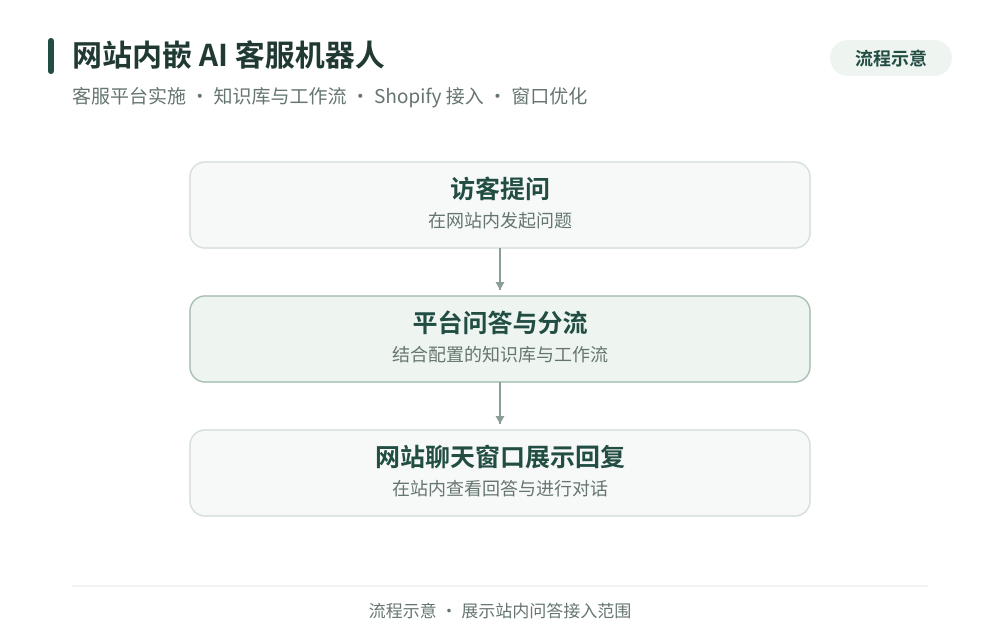
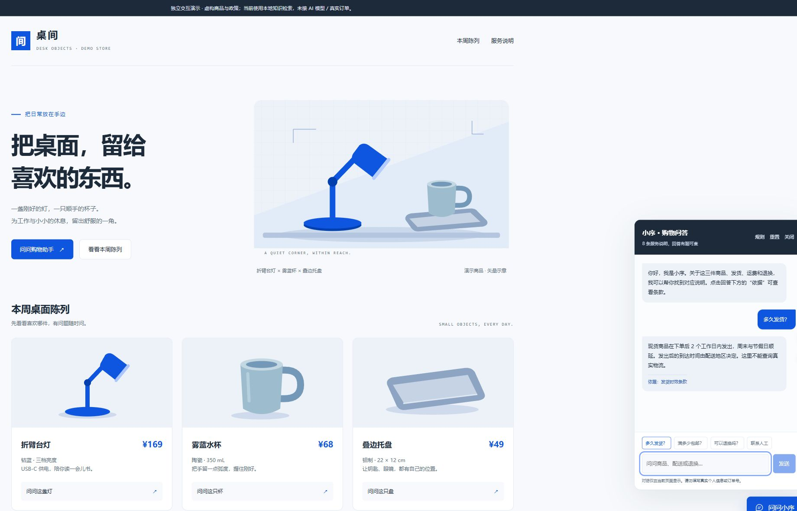
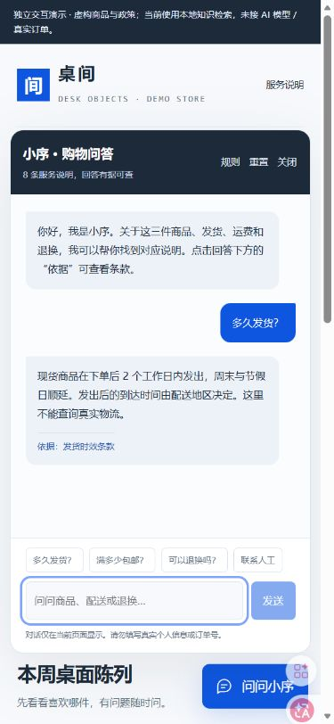

# 网站内嵌 AI 客服机器人

[返回作品集](../README.md)

这是我此前为独立站实施的网站 AI 客服项目。我以第三方客服平台为基础，配置知识库与工作流，完成 Shopify 后台接入，并优化聊天窗口的展示与交互，让访客能够在网站内提问和查看回答。

**业务场景**

网站客服需要同时处理信息内容、对话路径和站内体验。仅放入一个聊天入口，还需要准备可供回答的资料，配置问题如何进入对应流程，并让窗口在现有网站中能够正常展示和使用。

**我的实施范围**

我个人负责客服平台的实施与配置、知识库资料整理及接入、问答与分流工作流配置、Shopify 后台接入，以及聊天窗口 UI 的优化与调试。交付重点是把平台能力配置成适合网站使用的客服功能。

| 模块 | 实施内容 |
| --- | --- |
| 客服平台 | 配置网站使用的客服功能与对话入口 |
| 知识库 | 整理问答资料，接入平台作为内容来源 |
| 工作流 | 配置问答与分流路径，组织对话处理过程 |
| Shopify 接入 | 在网站后台完成客服平台的接入配置 |
| 聊天窗口 | 调整 UI 与交互展示，配合站点进行调试 |

**问答使用流程**

| 环节 | 网站中的行为 |
| --- | --- |
| 发起问题 | 访客从站内客服入口提出问题 |
| 进行问答 | 客服平台结合知识库与工作流处理对话 |
| 查看回复 | 访客在站内查看问答结果 |

## 可体验的独立交互演示

我另行为作品集从零制作了一个虚构网店示例，展示商品咨询、知识条款溯源、未知问题分流与人工请求预览。下图来自该演示，不是原项目后台或生产页面。当前版本使用本地 FAQ 检索，没有接入语言模型、真实订单或消息发送。

[在线体验独立演示](https://super-chestnut.github.io/portfolio/examples/customer-assistant.html) · [打开演示说明与下载入口](../examples/storefront-guide.md)

**可以承接的服务**

- 第三方 AI 客服平台的站点接入与配置实施。
- 客服知识资料整理、知识库接入与工作流配置。
- Shopify 聊天窗口接入、UI 优化、调试和使用交接。

**实施中需要明确的问题**

知识资料要适合问答使用，工作流要有清楚的进入条件和去向，聊天窗口也要与网站布局协调。交付时可以围绕典型问题检查回答、分流和窗口交互，再整理配置说明，方便后续维护。

合作从现有网站、客服平台和可用资料开始，先明确问答场景与验收样例，再安排接入、配置和体验调整。

[返回作品集](../README.md) · [沟通项目需求](https://github.com/super-chestnut/portfolio/issues/new)
