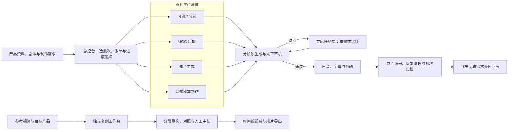

# AI 视频生产与交付体系

[返回作品集](../README.md)

我独立搭建了覆盖五种制作路线的 AI 视频生产体系，并将其中四套接入统一总控，让团队能够集中提交任务、跟踪进度、审核素材和整理交付。

**项目概况**

| 项目 | 内容 |
| --- | --- |
| 服务场景 | 电商产品广告与短视频内容制作 |
| 我的职责 | 需求梳理、流程与界面设计、开发集成、测试部署、迭代维护 |
| 系统范围 | 五套视频生产工具，以及编排其中四套的总控台 |
| 交付形式 | 本地工作台、后台任务、共享素材与成片库、飞书协作接入 |

**解决的问题**

制作一条广告，通常需要找产品资料、设计内容、生成素材、下载文件、审核重做、制作声音字幕、剪辑和归档。批量制作时，还需要持续判断哪条在生成、哪项待审核、失败从哪里继续、哪个版本应该交付。

我把这些重复操作整理成任务和状态明确的流程，并针对不同广告形式保留独立制作路线。使用者可以根据创意、现有资料和修改需求选择工具，再通过审核和任务管理组织批量交付。

**五条制作路线**

| 制作路线 | 如何工作 | 适合的需求 |
| --- | --- | --- |
| 可组合分镜 | 编排产品与生活方式镜头，逐镜生成、审核和重做，再完成后期 | 镜头与卖点需要灵活组合，个别画面需要单独替换 |
| UGC 口播 | 组织人物讲述、产品展示画面、声音和字幕，分段审核与制作 | 产品推荐、讲解和使用演示 |
| 整片生成 | 编排完整方案，通过一次主要视频请求生成，再进行声音字幕处理 | 快速探索完整短片、开箱、测评与原生分享形式 |
| 完整剧本制作 | 从完整剧本进行导演拆解，按需组织人物、场景、首帧和生成段 | 有明确叙事、台词与镜头逻辑的广告 |
| 参考片复刻 | 拆解参考片的镜头与节奏，围绕目标产品分段重构和组装 | 保留参考结构、调整产品与画面、制作同风格版本 |

前四条由总控台统一编排；参考片复刻使用独立工作台。

**从需求到交付的流程**

**三个关键实现**

1. **任务能够持续推进。** 将生成、下载、审核、后期和交付组织为可追踪的阶段。出现失败时保留原任务关系和已完成结果，便于从具体环节继续。
2. **修改能够落到具体素材。** 为适用路线提供逐镜或逐段审核、替换与重做入口，让修改围绕问题素材展开。
3. **制作能够接入团队协作。** 将产品、批次、原任务和成片关联起来，集中处理审核、归档、版本和交付，减少人工切换页面与核对文件。

**工作方式的变化**

| 原来的操作 | 系统组织后的操作 |
| --- | --- |
| 多个产品分别重复录入、逐条建立任务 | 按批次组织需求并分配制作路线 |
| 在不同工具间查找生成进度和待审素材 | 从统一入口查看进度与集中审核 |
| 失败后重新核对素材、任务与下载结果 | 根据保存的阶段和原任务继续处理 |
| 人工整理文件名、版本和交付位置 | 统一编号、版本管理、批次归档与回写 |

自动化推进重复工作，人工负责创意选择、素材质量和最终交付确认。

**我可以为你交付什么**

- 根据产品、内容形式和团队现有工具，设计一条或多条 AI 视频生产路线。
- 开发批量任务、素材审核、局部重做、进度追踪和失败恢复工作台。
- 接入素材与角色复用、字幕配音、视频后期及成片归档。
- 对接飞书或既有业务系统，组织需求、任务和交付结果。
- 完成部署、操作说明与后续迭代。

可以先从一条明确的制作流程开始，再扩展其他路线与协作模块。

**主要技术**

Python · Node.js · Streamlit · SQLite · FFmpeg / FFprobe · 模型 API · 飞书 API

本页以匿名业务场景介绍个人的设计与交付能力。

[返回作品集](../README.md) · [沟通项目需求](https://github.com/super-chestnut/portfolio/issues/new)

