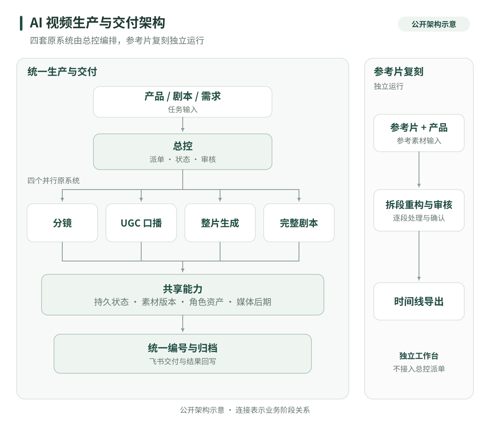
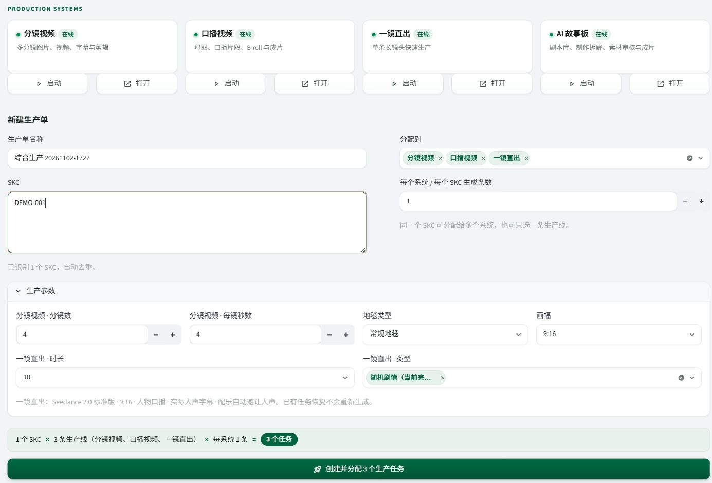

# 独立构建五路线 AI 视频生产与协作交付体系

[返回作品集](../README.md)

我独立设计、开发并维护五套具有不同制作流程的 AI 视频工具，并开发总控台统一编排其中四套。工作覆盖需求分析、产品交互、模型与业务接口集成、任务调度、媒体后处理、部署交付和持续迭代。

| 系统规模 | 我的职责 | 交付形态 |
| --- | --- | --- |
| 五条制作路线、四套总控接入、一个独立复刻工作台 | 从需求到开发、部署与维护独立负责 | 生产工作台、后台任务、审核入口、共享资产与成片交付 |

## 业务问题

内容团队需要持续围绕多个产品制作不同形式的广告。逐条制作涉及取图、设计内容、生成素材、查询下载、审核重做、声音字幕、剪辑和回传。批量推进时，还要解决任务依赖、版本归属、失败恢复和跨工具协作。

我将这些操作拆成可保存、可继续、可审核的生产阶段，再针对内容结构建立独立制作路线，让团队可以选择合适的制作方式，并从统一入口组织批量任务和结果。

## 五套工具的工作量体现在哪里

| 制作路线 | 独立实现的流程与模块 | 适用的内容需求 |
| --- | --- | --- |
| 可组合分镜 | 产品与参考输入、分镜编排、共享人物或场景、图片与视频队列、逐镜审核、局部替换、声音字幕与剪辑 | 卖点与场景需要自由组合，个别镜头需要精细修改 |
| UGC 口播 | 人物身份母图、姿势变体、英语脚本、分段人物视频、B-roll 规划、声画覆盖、阶段审核与合成 | 人物推荐、讲解与产品使用演示 |
| 整片生成 | 完整广告方案编排、参考素材角色检查、一次主要视频请求、异步查询下载、语音字幕与声音后期、任务存档 | 原生自拍、开箱、测评等完整短片探索 |
| 完整剧本制作 | 剧本库与批次排重、结构化导演拆解、台词约束、人物场景与首帧、生成段规划、阶段审核和缓存恢复 | 有叙事、明确台词和镜头逻辑的广告 |
| 参考片复刻 | 切镜与区间拆段、目标产品参考、逐段视频重构、原片结果对照、时间线组装、声音与字幕版本、恢复导出 | 参考结构改编、产品替换与同风格版本 |

前四条由总控台统一编排，参考片复刻通过独立工作台交付。五条路线保留不同输入、素材依赖、审核对象和后期方式。

## 系统结构与总控职责

总控台提供任务编排、集中审核、运行监控、角色库和成片库。适配层保留原系统各自的方案和生产能力，保存需求、批次、原任务、素材和交付之间的关联。

| 协作模块 | 具体实现 |
| --- | --- |
| 任务编排 | 读取手工生产单或业务需求，检查产品与参数，预览分配并建立原任务关联 |
| 集中审核 | 汇集不同系统的图片与视频，按素材身份和版本处理通过、退回及重做 |
| 运行监控 | 区分等待审核、远端排队、重做、失败和需要人工处理，继续原任务或进入对应工作台 |
| 共享资产 | 管理人物与宠物来源、审核、启停、标签和复用，减少旧任务清理对共享素材的影响 |
| 成片交付 | 统一编号、版本发布、批次归档、媒体检查、附件回传和状态同步 |

## 六个核心工程问题

### 1. 多阶段、跨任务的依赖调度

人物、场景、分镜图、视频和后期存在先后依赖，不同任务又可以交错推进。我将任务阶段和依赖保存下来，让已经具备输入的素材进入相应队列，生成与本地后期分别安排，避免一个环节等待时阻塞整批工作。

### 2. 中断恢复与不确定的远端提交

网络中断、页面关闭与平台失败有不同含义。系统持久化原任务、阶段、远端任务号和已有素材；恢复时优先查询和复用已完成结果。对已提交但结果未知的请求保留待处理状态，避免把刷新或超时直接变成再次购买生成。

### 3. 人工审核必须对应当前素材版本

同一镜头可能不断重做，旧界面也可能还停留在上一版。审核动作绑定系统、素材身份和版本；提交前再次检查当前记录，旧版本或已处理项不能重复通过。单卡片处理与列表刷新分开，减少操作其他卡片时播放器被重载的问题。

### 4. 局部重做保留已完成的工作

退回发生在具体镜头、片段或资产上。重做保留原任务关系、旧版本与远端记录，新版重新进入审核；依赖已满足的部分继续推进。方案调整、素材修改和整条重生分别处理，使返工落到实际需要修改的范围。

### 5. 多系统并发发布保持统一编号

四套系统共享正式成片编号注册表，分配在数据库事务中进行。同一任务重做保留自己的编号，不同任务不能占用同一序号。发布时核对归属、版本与媒体可读性，再原子写入，降低正式文件被半成品或兼容扫描覆盖的风险。

### 6. 生成完成与业务交付分别记录

本地出片、附件上传和业务表回写各有状态。回传按内容哈希识别视频，避免同名新版误用旧附件；后台进程与写回轮次有互斥保护。上传或表格故障可以单独恢复，无需重新生成已经完成的视频。

[阅读更详细的工程设计说明](../technical-notes.md) · [查看独立编写的恢复机制演示](../examples/workflow-guide.md)

## 真实界面与产物

以下为实际工作台与已有制作结果的局部截图。派单表单使用未提交的演示编号；不同截图展示不同环节，不构成同一任务的全流程录屏。

### 多系统任务编排

在同一入口选择生产路线、配置参数，并预览待创建任务。

### 分镜预览与逐镜审核

原分镜工作台按镜头呈现图片与审核结果，便于逐项查看。

### 多样化成片画面节选

展示不同人物、产品与内容形式的已有成片画面。公开节选裁去了商品编号、任务记录和字幕区域。

## 交付价值与可承接范围

这套体系将反复打开多个工具、逐项查询下载和人工整理文件的工作，组织为有任务状态、素材审核和交付关联的流程。人工集中处理需求、创意和画面质量，后台接续重复步骤。

我可以为内容团队交付：一条定制生成路线、批量生产工作台、多系统适配、素材与版本审核、失败恢复、声音字幕后期，以及与现有业务系统连接的成片交付流程。

**主要技术：** Python · Node.js · Streamlit · SQLite · FFmpeg / FFprobe · 模型 HTTP API · 飞书 API · 后台进程与系统适配器。

[返回作品集](../README.md) · [沟通项目需求](https://github.com/super-chestnut/portfolio/issues/new)

