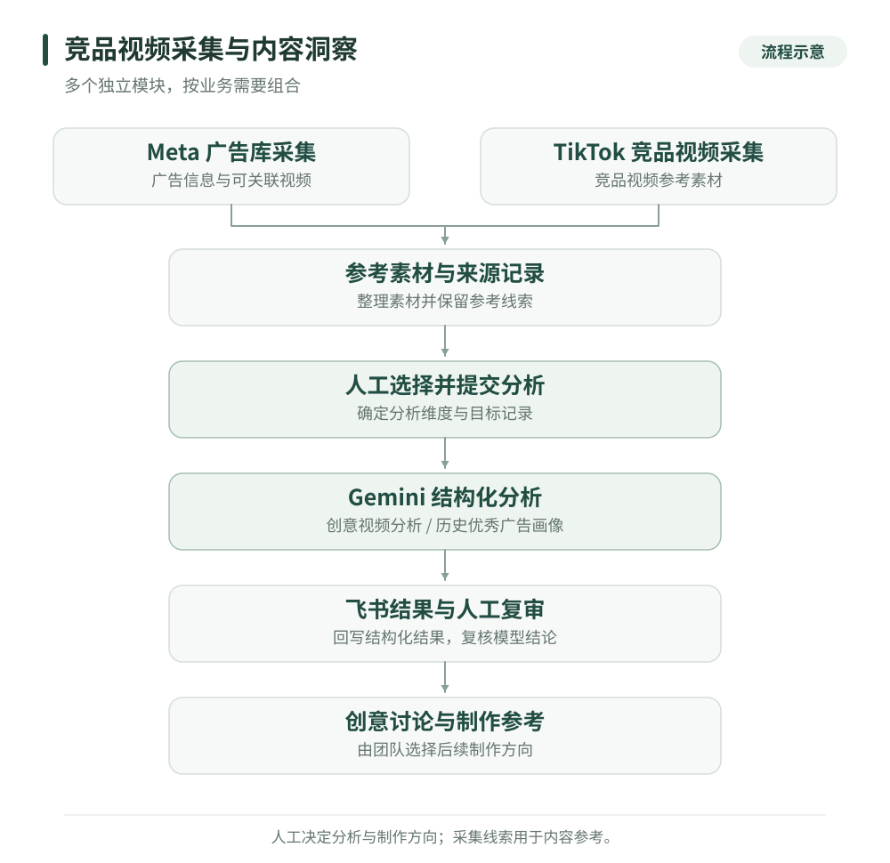

# 竞品视频采集与内容洞察工具

[返回作品集](../README.md)

我围绕电商团队寻找参考、理解内容和沉淀素材的工作，分别开发了 Meta 广告库采集插件、TikTok 竞品视频采集工具，以及基于 Gemini 的视频分析与飞书回写流程。这些模块可以按需要组合，采集后的素材由人选择分析与制作方向。

**业务问题与我的职责**

竞品视频分散在不同平台。运营需要反复打开页面、记录广告信息、下载素材，再把观看后的判断写进表格。即使积累了很多链接，也难以快速比较开头钩子、内容结构和制作要求。

我独立完成需求梳理、采集与分析流程设计、工具开发、接口集成、部署交付和后续迭代，将平台信息、视频文件和分析结论组织为可继续使用的素材记录。

**三个模块，保留各自的工作方式**

| 模块 | 输入与处理 | 交付结果 |
| --- | --- | --- |
| Meta 广告库插件 | 在已登录的广告库页面采集广告卡，解析编号、投放时间和创意复用信息，筛选参考线索并关联视频 | 广告记录、可下载素材、去重后的飞书素材条目 |
| TikTok 竞品视频采集 | 围绕竞品爆款视频进行收集，服务于后续选题和内容参考 | 竞品视频参考素材 |
| Gemini 视频分析 | 从飞书领取人工提交的视频，进行结构化分析，并按所选字段组回写原记录 | 内容标签、首屏钩子、脚本骨架、受众、制作难度与改编建议 |

Gemini 分析包含两条路线：一条拆解社媒创意视频，另一条为人工筛选的历史优秀广告提取首屏、买家需求、证明方式和分镜模块。两者使用不同的分析任务和字段。

**四个实际工程问题**

1. **广告卡和视频来源容易错配。** 页面文字与媒体可能位于不同节点，重复扫描也可能得到不完整结果。Meta 插件按完整广告卡收集信息并合并记录；对浏览器临时媒体地址与可关联的 CDN 来源分别处理，保留无法下载的情况。
2. **同一素材会从不同入口反复出现。** 本地下载去重不足以保护已有素材库。我在同步端结合素材标识、规范化链接、视频文件哈希和历史附件信息判断重复，避免仅凭文件名建立新记录。
3. **模型结果需要适配真实业务表。** 标签、结构化输出与飞书字段必须对应。分析结果按字段映射写入，可选择只更新部分维度，并保留人工已经推进的制作状态；普通输出字段发生变化时，也需要避免整条记录因此失效。
4. **采集线索和分析假设容易被当成效果结论。** 长期投放和创意复用用于筛选参考；优秀样本分析用于提出共性与假设。系统将这些口径写入分析规则，内容判断仍由人复审，模型不据此推断竞对转化数据。

**我可以交付的服务**

- 为指定平台和业务范围开发素材采集、整理、去重与入库工具。
- 设计视频分析字段、标签与提示词，接入多模态模型和团队素材库。
- 开发批量分析队列、进度与错误回写、后台恢复及人工复审流程。
- 根据现有素材库交付部署说明、使用培训与维护方案。

**主要技术**

Meta 模块：Chrome Manifest V3、JavaScript、Python 本地服务。视频分析模块：Python、Google Gemini API、结构化输出与飞书 API。

[返回作品集](../README.md) · [沟通项目需求](https://github.com/super-chestnut/portfolio/issues/new)
