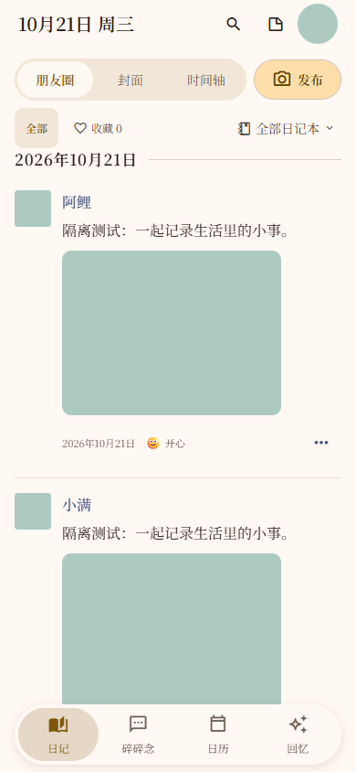
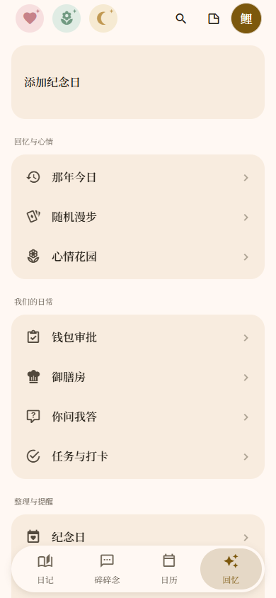
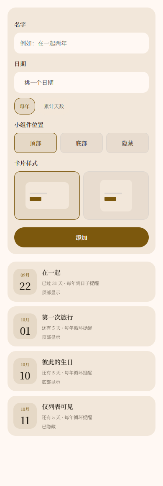

# Android 双人生活记录 App

[返回作品集](../README.md)

我独立开发了一款面向两人共同记录生活的 Android 产品，完成需求梳理、界面交互、前端与云端业务、原生能力接入、测试和签名安装包交付。产品从日记延伸到相册、回忆、日常协作与积分互动，需要同时处理个人可见规则、双人共享状态和离线后的数据恢复。

## 产品范围

| 模块 | 已实现的主要功能 |
| --- | --- |
| 记录与整理 | 图文日记、画画块、心情、评论回复、碎碎念；朋友圈／封面／时间轴三种样式；日记本、搜索与收藏 |
| 回忆与照片 | 月历、多相册、原图查看与保存、那年今日、随机漫步、心情与书写统计 |
| 双人日常 | 邀请配对、共同便利贴、纪念日与展示卡片、你问我答、钱包审批、点菜与后厨接单 |
| 任务与积分 | 自定义任务、每日打卡、对方确认、个人积分流水、菜品积分兑换 |
| 数据与维护 | 本地保存、云同步与冲突合并、备份导出恢复、应用内动态、设备激活、覆盖升级 |

## 真实界面

以下为使用演示数据运行的真实应用界面，不含私人日记。

| 日记与双人记录 | 日常工具入口 |
| --- | --- |
|  |  |

| 积分收入与流水 | 每条纪念日独立配置 |
| --- | --- |
|  |  |

## 五个核心工程问题

### 1. 双人共享中的访问与修改边界

服务端根据已验证身份确定所属双人空间，校验成员关系与操作角色。评论由作者修改，任务由另一人确认；配对加入也在事务中核验邀请码与成员数量。

应用界面另按“仅自己／两人可见／定时可见”规则展示日记，统计使用当前可见记录，动态消息不提前展示未公开正文。

### 2. 断网与同时编辑之后继续同步

普通记录先在本机保存，修改进入持久化同步队列；联网后逐类补传。客户端携带读到的版本号，服务端在事务中判断版本：出现冲突时返回最新数据，再合并重试，减少后保存的一端覆盖另一端内容的风险。

我也处理了本地写盘失败导致后续同步被阻塞的问题：将错误报告与串行队列恢复分开，存储恢复后重新拉取、严格落盘再更新界面。界面区分云端连接、本机保存失败和待补传状态，便于使用者判断自己的记录处于哪个阶段。

### 3. 带原图的备份与恢复

照片较多时，一次构造全部 Base64 和完整 JSON 会放大内存占用。我将 Android 导出改为分块读取原图、逐段写入数据，并分块复制到用户选择的文件夹。

备份先写临时文件，完成后再成为正式文件；失败保留已有备份，读取不到的照片明确提示遗漏。恢复兼容已有备份格式，重建图片引用并处理身份隔离。

### 4. 积分互动的事务与幂等

任务与打卡由对方确认后计分，余额由服务端账本计算。兑换菜品时，以当前价格校验余额，将扣分、建单和请求回执放在同一事务，避免扣分后没有订单或并发透支。

客户端先保存请求标识再发送；超时结果不明时使用同一标识重试，避免重复加分或扣分。积分缓存按身份与双人空间隔离，备份快照也不会重新作为奖励发放。积分用于产品内的任务与生活互动。

### 5. 原生激活与持续发布

设备激活由服务端事务核销并签发凭证，Android 原生模块验证签名与本机绑定，通过 Keystore 加密保存；已激活设备可以在本机验证后离线打开应用。

我保留原应用签名与本地数据结构，持续交付可覆盖安装的 APK，并核对版本、签名、包内源码和实际运行代码。激活资格恢复与日记恢复分别处理，避免把重新激活误当作数据恢复。

## 从功能到可维护产品

界面沿用统一主题与中文字体，处理窄屏、较大字号、长文本、弹层和照片拖动；长列表使用虚拟化，编辑草稿保存在列表之外。同步、备份、积分和原生模块均有独立故障处理与回归检查。

产品持续维护至 **0.4.50**，围绕同步、备份、角色约束和积分建立回归检查，并维护签名 APK 的覆盖升级。

## 可迁移的交付能力

这项产品体现了我从交互到云端、从离线数据到原生模块、从功能开发到版本维护的完整交付能力。相关设计可以用于生活记录、双人或小团队协作、打卡审批、积分互动、图片管理与离线工具等移动产品。

**主要技术：** React Native · Expo · JavaScript · 云函数与事务数据库 · Android Kotlin · Keystore · 自动化回归与签名发布

[返回作品集](../README.md) · [沟通项目需求](https://github.com/super-chestnut/portfolio/issues/new)
