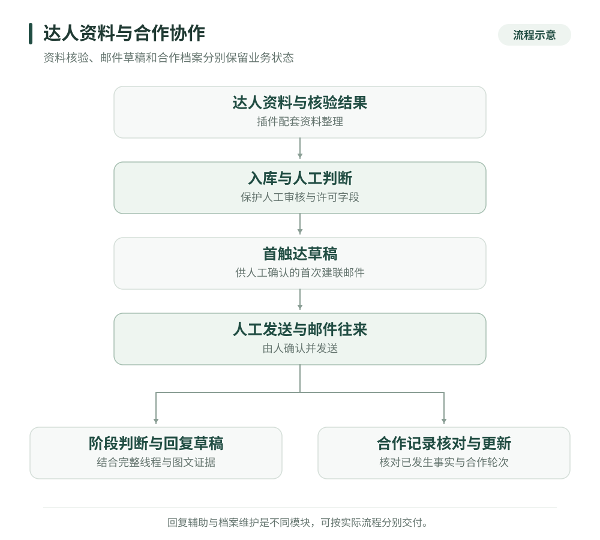

# 达人资料核验与合作协作工具

[返回作品集](../README.md)

我围绕达人资料整理、首次建联、邮件往来和合作记录维护，开发了浏览器插件配套服务、Gmail 草稿辅助与飞书同步工具。它们覆盖不同业务环节，可以分别部署，也可以按团队流程连接。

**业务问题与我的职责**

达人合作需要在社媒主页、邮箱和业务表之间不断切换。资料可能不完整，同一个人会以不同账号形式出现；已经进入选品或内容提交阶段的合作，也可能因为只看最新一封邮件而被误判为初次接洽。

我独立负责需求分析、合作阶段与字段设计、开发集成、部署交付和迭代，将资料核验、人工判断、邮件草稿与合作档案组织成有状态、有依据的流程。

**按业务环节拆分的模块**

| 模块 | 输入与处理 | 交付结果 |
| --- | --- | --- |
| 达人插件配套服务 | 接收 Instagram 资料与核验结果，规范化账号、整理公开联系方式和内容表现信息 | 可审核的达人记录与飞书入库结果 |
| 首次建联与跟进 | 读取人工合格记录，检查联系方式、既有草稿及会话，再创建邮件草稿 | Gmail 草稿、触达状态、后续跟进记录 |
| 合作回复辅助 | 结合完整邮件线程、图片证据和合作规则，判断当前阶段并起草、复审 | 供人工确认发送的回复草稿 |
| 合作档案维护 | 汇总邮件与既有业务记录，匹配达人及具体合作轮次 | 合作明细、达人主档、冲突与待补项 |

档案维护是独立的数据核对流程，处理已发生的合作事实。浏览器核验与建联工具处理前期资料和沟通，两者保留各自的状态与规则。

**四个实际工程问题**

1. **同一达人和同一合作轮次难以识别。** 我对邮箱和社媒账号做规范化，使用稳定身份进行匹配；订单与物流信息帮助区分不同合作轮次，显示名称不作为唯一依据。遇到身份冲突时保留待核对项。
2. **程序同步容易覆盖人工判断。** 达人核验结果与人工合格、触达许可分别维护，入库时保护人工负责的字段。档案更新也保留可信的已有值，未知信息保持空缺，避免把缺失信息写成已确认事实。
3. **邮件阶段依赖完整的图文证据。** 回复流程综合历史线程、当前来信、OCR 和视觉结果，区分建联、选品、订单、内容提交及发布等阶段。证据不足或需要人工决定的事项进入人工处理；生成与复审共用阶段规则，避免流程无依据倒退。
4. **草稿与跟进不能反复触发。** 首次建联检查既有草稿和线程标识；已收到回复时停止自动跟进起草。系统还回读保存后的草稿，核对对象、内容与阶段，并保护人工修改。最终发送由人完成。

**我可以交付的服务**

- 达人资料整理、核验结果入库与人工审核工具。
- Gmail 首触达、合作回复和跟进草稿辅助。
- 邮件、社媒身份和合作轮次匹配，以及业务表清理与同步。
- 合作阶段规则、图文证据处理、异常清单、部署与交接说明。

具体交付可从“资料入库”或“邮件草稿”一个环节开始，再按实际使用需要增加合作记录与跟进模块。

**主要技术**

浏览器扩展与本地 HTTP 桥接 · Python · Gmail API · 飞书多维表格 · OCR / 视觉模型 · 结构化业务规则

[返回作品集](../README.md) · [沟通项目需求](https://github.com/super-chestnut/portfolio/issues/new)
