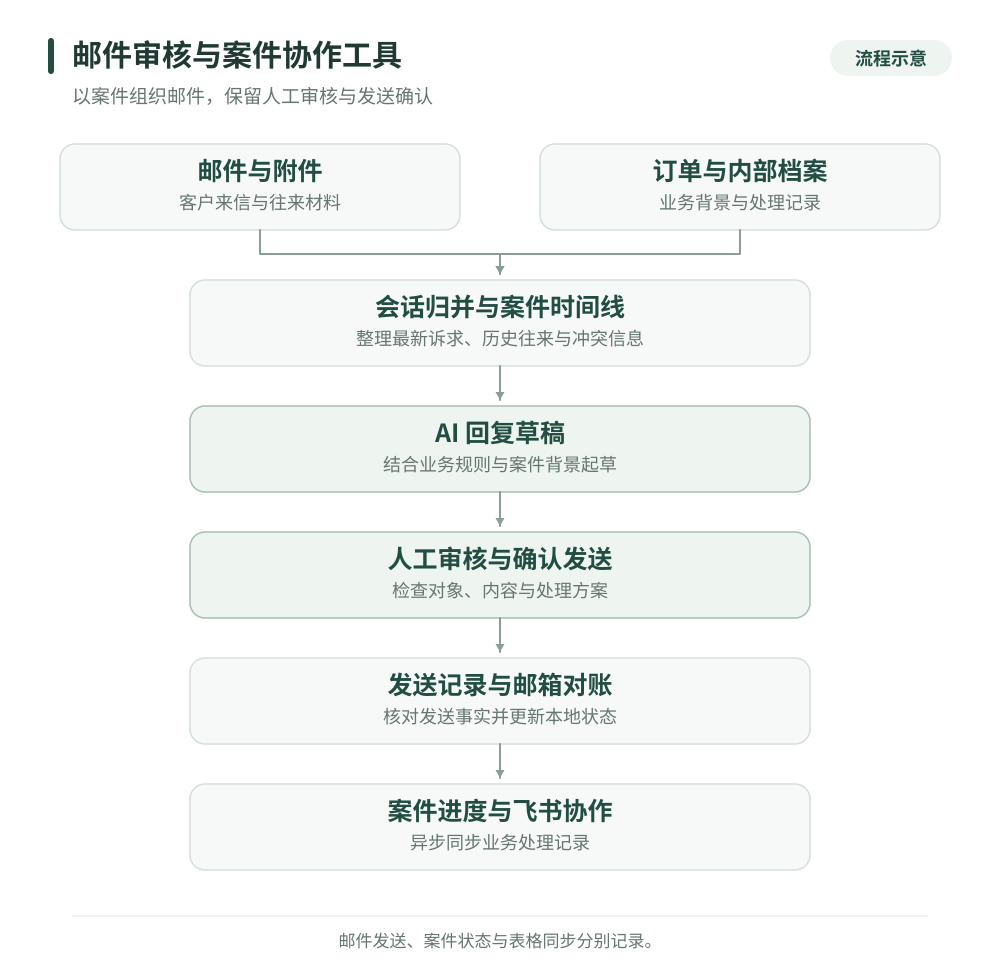

# 邮件审核与案件协作工具

[返回作品集](../README.md)

我独立开发了一套面向电商售后的邮件辅助系统，把邮件分类、历史往来、订单信息、回复起草、人工审核与案件进度放进同一流程。AI 负责整理与起草，客服在审核台确认处理方案并触发发送。

**业务问题与我的职责**

售后邮件经常围绕同一件事反复往来，订单、物流和处理进度又分散在邮箱、店铺后台与内部表格。只看一封新邮件，容易漏掉先前承诺；逐封处理，也可能让已回复的旧轮次继续留在待办里。

我负责需求分析、案件与状态模型、审核页面、邮件及业务接口集成、异常处理、部署交付和维护。设计重点是让客服看清“这件事到了哪里、现在还需要回复什么、哪些信息需要人工确认”。

**从邮件到案件的处理流程**

| 环节 | 如何处理 | 交付结果 |
| --- | --- | --- |
| 收集与归并 | 读取企业邮箱邮件及附件，按引用关系、对象和问题整理会话 | 案件、邮件历史与时间线 |
| 补齐背景 | 查询 Shopify 订单，读取内部售后档案并与邮件互校 | 订单背景、已发生动作与冲突提示 |
| 起草与审核 | 结合业务规则生成英文草稿，提供改写、驳回、转人工与发送预览 | 人工确认后的回复 |
| 对账与协作 | 核对邮箱已发送记录，更新本地状态，异步同步飞书 | 可继续跟进的案件与处理记录 |

**四个实际工程问题**

1. **邮件数量和待处理事项数量不同。** 我把案件作为处理单位，归并同一议题的多次来信，标识已被后续来信取代的旧草稿，并用等待时长与紧急信号组织队列。审核页面同时展示往来与当前进度，帮助客服围绕最新诉求处理。
2. **内部档案与邮件事实可能不一致。** 起草时对照实际往来与内部记录，明确冲突来源。既有邮件承诺形成约束，模型不能无依据降低已有处理条件或增加新承诺；多个候选订单无法确定时保留人工核验。
3. **发送中断后无法直接判断是否发出。** 系统用 SQLite 发送记录与稳定邮件标识防重。遇到发送状态不确定时，先只读核查邮箱已发送记录；无法确认就保留人工处理，避免再次点击造成重复回复。发送前还检查收件人、订单、正文占位符与业务规则。
4. **邮箱成功不代表业务表同步成功。** 邮件发送、案件状态和飞书事件分别记录。表格写入经本地 outbox 异步处理，使用幂等键与退避重试；同步失败只处理相应事件，避免把外部表格故障扩散成再次发信。客服直接在邮箱发出的回复也可通过对账补回状态。

**我可以交付的服务**

- 基于企业邮箱的分类、会话整理和回复草稿工具。
- 接入订单查询与内部知识资料的客服审核工作台。
- 案件认领、时间线、待办队列、已发送对账与协作记录。
- 邮件与业务系统集成、异常恢复、访问控制、部署及交接文档。

交付时可围绕一个明确售后场景确定规则与验收样例，再逐步扩展其他问题类型和协作接口。

**主要技术**

Python · 本地 Web 审核台 · IMAP / SMTP · SQLite · 大模型 API · Shopify API · 飞书 API · 后台任务与异步 outbox

[返回作品集](../README.md) · [沟通项目需求](https://github.com/super-chestnut/portfolio/issues/new)
